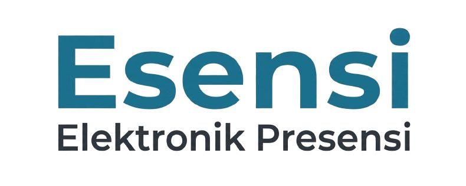

<p align="center">
  
</p>

<h1 align="center">esensiv2 — Sistem Presensi (GPS + Foto + Wajah)</h1>

<p align="center">
  <a href="https://github.com/IT-BLKM/esensiv2/actions/workflows/ci.yml"></a>
  
  
  
  
</p>

---

## Tentang

Rewrite total dari sistem **presensigps** (Laravel 8) menjadi aplikasi modern: **Laravel 13 + PHP 8.5**,
arsitektur *thin controller, fat action*, database MariaDB lewat migration, dan **CI otomatis (Pint + PHPStan + Pest)**
di setiap Pull Request.

Sistem ini mengelola absensi karyawan berbasis **GPS + foto + deteksi wajah**, pengajuan cuti/sakit/dl
dengan aturan PNS, serta monitoring dan laporan kehadiran.

> Dokumen rancangan (sumber kebenaran untuk migration & pengembangan):
> **[`docs/database-design.md`](docs/database-design.md)**

---

## Fitur

| Area | Isi |
|---|---|
| **Presensi** | Absen masuk/keluar dengan foto (webcam), **wajah wajib terdeteksi**, koordinat GPS otomatis, cek radius kantor di server, kamera & tombol absen terlihat tanpa scroll |
| **Jadwal kerja** | Master shift + penugasan per hari per pegawai (Senin–Minggu) + **hari libur nasional** yang tidak dihitung hari kerja |
| **Cuti & pengajuan** | Tahunan, Bersalin, Alasan Penting, Besar + Sakit/DL; kuota 12 hari/tahun + tabungan 2 tahun (maks 24 hari); hari libur tidak mengurangi kuota; pegawai dapat membatalkan pengajuan pending; approval dalam transaksi |
| **Monitoring** | Kehadiran harian, peta koordinat, rekap keterlambatan bulanan/tahunan |
| **Laporan** | Laporan bulanan per pegawai/semua pegawai, TL/PSW per hari, penanda `H!` untuk TL yang diganti, ekspor **PDF/Excel A4 portrait** dengan header Kemenkes |
| **TUKIN** | Rekap & rincian potongan tunjangan kinerja, nominal opsional per jabatan, kunci periode payroll, koreksi ber-audit, slip/berita acara PDF, rekap per departemen + tren 12 bulan, halaman TUKIN pegawai, aturan TL/PSW dapat diedit admin |
| **Keamanan** | Otorisasi per role, anti-IDOR, throttle login, foto absen tersimpan privat, periode payroll terkunci, tanpa SQL string concat |

---

## Persyaratan

- **PHP 8.5** (minimal 8.3) + ekstensi: `pdo_mysql`, `mbstring`, `dom`, `fileinfo`, `openssl`, `curl`
- **Composer 2**
- **MariaDB 11** (atau MySQL 8)
- **Node.js 20+** & npm (untuk build asset Vite)
- **GitHub CLI** (`gh`) — untuk alur issue/PR tim

Cek kesiapan mesin:

```bash
php -v
composer check-platform-reqs
```

---

## Setup lokal

```bash
# 1. Clone & install dependency
git clone https://github.com/IT-BLKM/esensiv2.git
cd esensiv2
composer install
npm install

# 2. Environment
cp .env.example .env
php artisan key:generate

# 3. Database — buat dulu db 'presensi' di MariaDB, lalu isi di .env:
#    DB_CONNECTION=mysql, DB_HOST, DB_PORT=3306, DB_DATABASE, DB_USERNAME, DB_PASSWORD
php artisan migrate --seed

# 4. Build asset & jalankan
npm run build
php artisan serve          # http://127.0.0.1:8000
```

### Akun demo (hanya non-produksi)

`php artisan migrate --seed` mengisi master data + 50 pegawai dengan riwayat presensi
tiga bulan. Password semua akun demo: `password`.

| Akun | Peran |
|---|---|
| `admin@esensi.test` | Admin |
| `pegawai@esensi.test` … `pegawai50@esensi.test` | Pegawai |

Di produksi `db:seed` **hanya** mengisi master data (departemen, shift, cuti, hari
libur, aturan TUKIN) tanpa akun demo. Buat admin pertama dengan
`php artisan admin:create admin@domain-resmi`.

### Konfigurasi lokasi kantor

Lokasi & radius absen dapat diubah admin lewat menu **Konfigurasi**. Nilai di tabel
`pengaturan` menang atas `config/presensi.php`; `.env` menjadi nilai awal/fallback:

```dotenv
PRESENSI_LAT=-6.200000      # lintang kantor
PRESENSI_LONG=106.800000    # bujur kantor
PRESENSI_RADIUS=150         # radius dalam meter
```

Default development memakai radius 25 km agar tidak perlu titik GPS sungguhan;
isi nilai produksi yang sebenarnya lewat menu Konfigurasi atau `.env`.

---

## Perintah penting

| Perintah | Fungsi |
|---|---|
| `php artisan migrate --seed` | Bangun database + data awal |
| `php artisan admin:create <email>` | Buat/reset akun admin pertama (produksi) |
| `php artisan pegawai:set-password-default` | Reset password awal seluruh akun pegawai |
| `php artisan cuti:rollover-tahunan` | Rollover tabungan cuti tahunan (idempotent) |
| `php artisan presensi:import-lama` | Impor data lama presensigps (lihat runbook ETL) |
| `php artisan serve` | Server development |
| `npm run dev` | Vite watch (hot reload asset) |
| `npm run build` | Build asset untuk produksi |
| `vendor/bin/pint` | **Perbaiki** gaya kode otomatis |
| `vendor/bin/pint --test` | **Cek** gaya kode (seperti di CI) |
| `vendor/bin/pest` | Jalankan seluruh test |
| `vendor/bin/pest --filter=NamaTest` | Jalankan satu test |
| `vendor/bin/phpstan analyse` | Analisis statis (Larastan level 5 + baseline) |

---

## Continuous Integration

Setiap push & Pull Request menjalankan tiga job di **`.github/workflows/ci.yml`**:

1. **Pint** — `vendor/bin/pint --test`. Gagal = ada kode yang belum rapi → jalankan `vendor/bin/pint` lalu commit ulang.
2. **PHPStan** — `vendor/bin/phpstan analyse` (Larastan level 5 + baseline).
3. **Pest** — `vendor/bin/pest` di atas **MariaDB 11** (service), bukan sqlite, supaya sama dengan produksi. Ada guard yang memaksa `DB_CONNECTION=mysql` supaya test tidak diam-diam jalan di sqlite.

Catatan teknis: `phpunit.xml` bawaan Laravel menyetel test ke sqlite `:memory:` untuk lokal; di CI nilai
`DB_*` datang dari `env:` workflow dan menang karena `<env>` di phpunit.xml tidak menimpa environment
yang sudah ada.

**`main` dilindungi branch protection** — PR hanya bisa di-merge bila Pint, PHPStan, dan Pest hijau.

---

## Arsitektur

Prinsip: **thin controller, fat action** — controller hanya menerima request dan memanggil Action.

```
app/
├── Actions/          # Logika bisnis (StorePresensi, ApprovePengajuan, HitungSisaCuti, ...)
├── Services/         # Logika lintas fitur (rekap keterlambatan, Haversine)
├── Http/
│   ├── Controllers/  # Tipis: validate → authorize → Action → response
│   ├── Requests/     # FormRequest — semua validasi input di sini
│   └── Middleware/    # Role admin/pegawai
├── Policies/         # Otorisasi (anti-IDOR)
└── Models/
```

Aturan yang tidak boleh dilanggar (lihat [`docs/panduan-kolaborasi.md`](docs/panduan-kolaborasi.md)):

- ❌ Tidak ada `whereRaw` dengan konkatenasi string (SQL injection)
- ❌ Tidak ada `echo` sebagai response API — pakai response JSON terstruktur
- ❌ Tidak ada validasi manual yang tersebar di controller — pakai FormRequest
- ❌ Semua akses data dicek Policy (`authorize()`), bukan cek manual yang mudah terlewat

---

## Kolaborasi

**Baca [Panduan Kolaborasi GitHub](docs/panduan-kolaborasi.md) sebelum kontribusi pertama.**

Ringkasnya:

```bash
git switch main && git pull && composer install   # ambil terbaru
git switch -c feat/15-judul-tugas                 # branch per tugas
vendor/bin/pint && vendor/bin/phpstan analyse && vendor/bin/pest   # wajib hijau
git push && gh pr create --fill --base main       # buka PR
```

- **Penulis kode menulis test** untuk fiturnya di PR yang sama.
- **QA** menulis kriteria diterima pada issue, me-review isi test, dan melakukan UAT manual sebelum rilis.
- Semua pekerjaan dikelola lewat **Issues + Projects board** (Fase 0–8).

---

## Dokumentasi

| Dokumen | Isi |
|---|---|
| [`docs/database-design.md`](docs/database-design.md) | Rancangan database final + aturan bisnis cuti, hari libur, dan TUKIN |
| [`docs/panduan-kolaborasi.md`](docs/panduan-kolaborasi.md) | Alur git/GitHub untuk tim: branch, commit, PR, merge, konflik |
| [`docs/konvensi-ui.md`](docs/konvensi-ui.md) | Design system, kontras, dua layout, konvensi komponen |
| [`docs/checklist-rilis.md`](docs/checklist-rilis.md) | Checklist keamanan dan verifikasi sebelum produksi |
| [`docs/migrasi-data-awal.md`](docs/migrasi-data-awal.md) | Alur go-live tanpa dump lama: master, hari libur, saldo cuti, TUKIN |
| [`docs/etl-runbook.md`](docs/etl-runbook.md) | Langkah impor data lama presensigps (issue #56) |
| [Issues](https://github.com/IT-BLKM/esensiv2/issues) | Daftar tugas pengembangan dalam 9 fase (Fase 0–8) |

---

## Catatan keamanan & privasi

- Repo ini bersih: **tidak ada** dump SQL, data pribadi (NIP/no HP), maupun foto absen yang boleh masuk git.
- `.env` tidak pernah di-commit. `.env.example` hanya berisi templat.
- Password disimpan ter-hash (Argon2id; bcrypt lama di-rehash saat login). Password awal
  pegawai hasil ETL wajib diganti setelah go-live — lihat [`docs/checklist-rilis.md`](docs/checklist-rilis.md).
- Foto absen disimpan di **disk privat** (di luar `public/`), diakses hanya lewat route ter-auth.

---

## Troubleshooting

| Gejala | Solusi |
|---|---|
| `SQLSTATE[HY000] Connection refused` | MariaDB belum jalan / `DB_*` di `.env` belum diisi |
| `MissingAppKeyException` | `cp .env.example .env && php artisan key:generate` |
| Test gagal soal foreign key / tabel tak dikenal | `php artisan migrate:fresh --seed` atau jalankan ulang `vendor/bin/pest` |
| Pint gagal padahal lokal aman | `composer update laravel/pint` lalu `vendor/bin/pint` |
| `vite` error saat build | `npm install` ulang |
